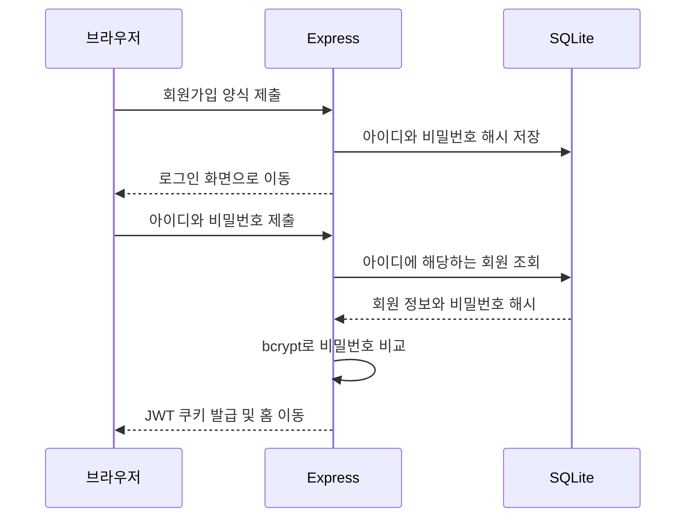
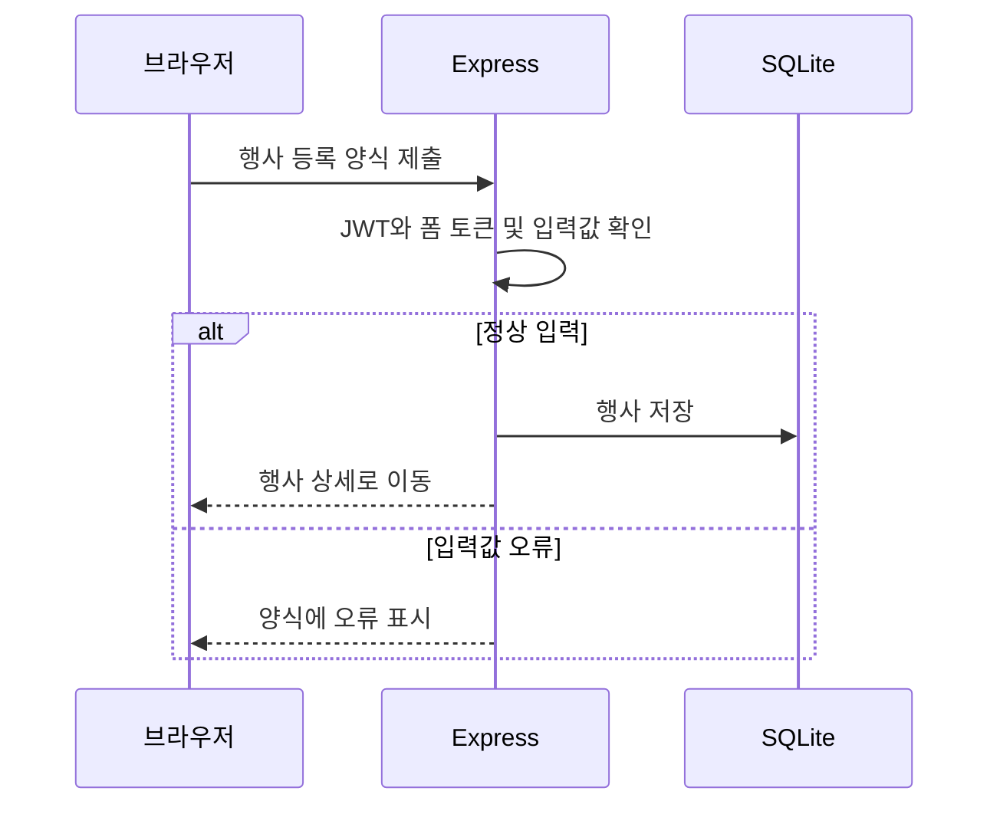

# 동네소식

동네 행사, 캠퍼스 축제, 팝업을 찾고 직접 홍보하는 모바일 웹 SNS입니다. Node.js 22 이상과 npm이 필요합니다.

## 실행

프로젝트 폴더에서 다음 명령을 실행합니다.

```powershell
npm ci
node -e "console.log(require('node:crypto').randomBytes(48).toString('hex'))"
```

`.env`가 없다면 프로젝트 폴더에 만들고 출력된 값을 `JWT_SECRET=생성한값` 형식으로 넣습니다. `JWT_SECRET`이 이미 설정되어 있다면 기존 값을 사용합니다. 이후 `npm start`를 실행한 뒤 http://localhost:3000 에 접속합니다. 첫 실행 시 SQLite 데이터 파일이 생성됩니다.

## 회원가입과 로그인

회원가입 화면에서 아이디와 비밀번호를 입력합니다. 비밀번호는 bcrypt 해시로 저장합니다. 가입 후 로그인하면 JWT 쿠키가 발급되고, 행사 등록·좋아요·댓글을 이용할 수 있습니다.

이전 버전의 SQLite 데이터는 서버 시작 시 자동으로 변환됩니다. 기존 글과 작성자 표시는 유지됩니다. 기존 카카오 회원은 새 아이디로 가입해야 하며 기존 글의 작성 권한은 새 계정에 자동 연결되지 않습니다.

휴대폰에서는 같은 네트워크의 서버 주소로 접속해 테스트할 수 있습니다. 배포 환경에서는 HTTPS와 `NODE_ENV=production`을 사용합니다.

## 요구분석과 기능 정의

| 사용자 | 기능 | 화면 및 결과 |
| --- | --- | --- |
| 방문자 | 행사 검색·분류·상세 조회 | 홈 피드에서 제목·장소 검색, 분류 필터, 상세 링크 |
| 방문자 | 아이디·비밀번호 회원가입 및 로그인 | 회원가입 후 로그인 화면으로 이동, 로그인 성공 시 홈으로 이동 |
| 회원 | 행사 홍보 | 제목·분류·날짜·장소·소개 등록, 본인 글 수정·삭제 |
| 회원 | 행사에 반응 | 상세에서 좋아요 추가·취소, 댓글 등록 |
| 회원 | 로그아웃 | 사이트 로그인 쿠키 삭제 후 홈으로 이동 |

## 화면 구조

- 홈 → 행사 상세 → 좋아요·댓글
- 홈 → 로그인 → 회원가입 → 로그인 → 홈
- 홈 → 행사 등록 → 상세 → 작성자 수정·삭제

## DB 설계

| 테이블 | 주요 컬럼 | 관계 |
| --- | --- | --- |
| users | id, username, nickname, password_hash | username 고유 |
| events | id, user_id, title, category, location, event_date, description | 작성자 한 명이 여러 행사 등록 |
| likes | user_id, event_id | 사용자와 행사 조합이 기본 키 |
| comments | id, user_id, event_id, body | 사용자와 행사에 각각 소속 |

행사를 삭제하면 연결된 좋아요와 댓글도 함께 삭제됩니다.

## 유스케이스와 시퀀스

- **행사 홍보** · 회원이 등록 버튼을 누르고 양식을 제출합니다. 성공하면 상세 화면으로 이동합니다. 필수값이나 날짜가 잘못되면 양식에서 안내를 표시합니다.
- **행사 탐색** · 방문자가 피드에서 분류와 검색어를 선택하고 행사 상세를 엽니다.
- **가입과 로그인** · 방문자가 회원가입을 하면 서버는 비밀번호를 bcrypt 해시로 저장합니다. 로그인 시 저장된 해시와 입력 비밀번호를 비교합니다.





## 코드 구조

`routes`에서 URL을 연결하고 `controllers`에서 요청을 처리합니다. `models`가 SQLite에 접근하고 `middlewares`가 JWT와 폼 토큰을 확인합니다. Express는 검색어와 분류를 처리하고, EJS는 행사 목록과 검색 결과, 상세 화면 및 입력 양식을 서버에서 렌더링합니다.
